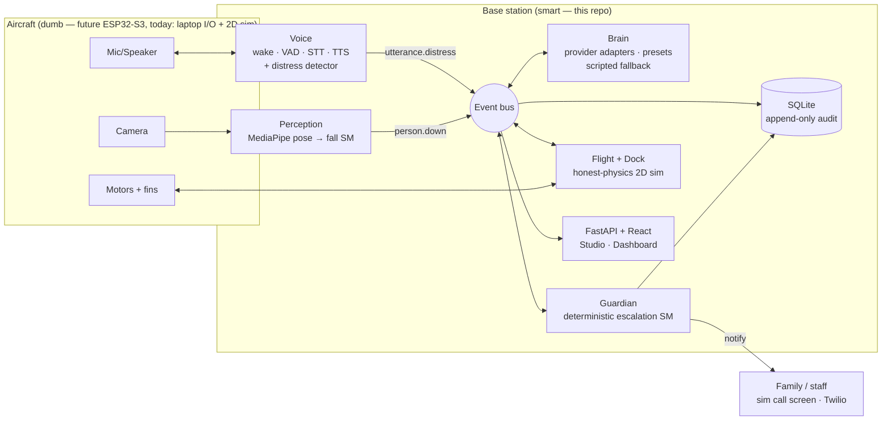

# Meemoo

A small, cute, **round** helium blimp that floats at eye level and serves as a
companion + safety check-in device for older adults — at home, in nursing homes,
and in hospitals. It holds conversations, gives reminders, remembers people
(without biometrics), and escalates to family or staff when someone asks for
help or the system detects a possible problem.

**Architecture in one line: the aircraft is dumb, the ground is smart.** The
blimp carries only a camera, mic, speaker, and steering motors (~65 g payload
on a ~120 L sphere). All intelligence lives in a wall-powered base station.
The hardware doesn't exist yet, so the entire brain is built against stand-ins:
laptop webcam/mic as the blimp's senses, a 2D simulator with honest physics as
the aircraft. When real hardware arrives, only the I/O drivers get swapped —
that is the whole bet, and the interfaces are the contract.

## 5-minute quickstart

Requires [uv](https://docs.astral.sh/uv/) and Node 20+.

```bash
git clone https://github.com/Acuntel/meemoo.git && cd meemoo
make install       # uv sync + npm install
make dev           # FastAPI :8000 + Vite dev server :5173, in parallel
```

Open http://localhost:5173 (or build once with `make web-build` and use
http://localhost:8000 — FastAPI serves `web/dist/`). Then:

1. **Setup Studio** → type instructions about the person ("You're checking on
   my mom Ruth, heart medication 8am and 8pm, she loves gardening…") →
   review the extracted config → save. No API key needed — extraction and
   conversation degrade to a deterministic scripted path.
2. **Dashboard** → the whale sits docked on the floor plan, next check-in
   scheduled (default 9a/1p/6p/9p).
3. **Run round now** → the whale drifts to the person's waypoint, the real
   voice pipeline runs the check-in (typed/text mode when no mic), returns,
   docks, and the timeline gains an entry.
4. **Fall demo without a camera**:
   `curl -X POST localhost:8000/api/v1/perception/replay -H 'content-type: application/json' -d '{"clip":"fall_no_response","speed":3}'`
   — a bundled landmark clip replays through the real fall state machine onto
   the live bus: `person.down` → whale flies over → "are you okay?" ×2 →
   escalation L1 → the simulated incoming-call screen takes over → Acknowledge
   halts it. With a webcam + `uv sync --group perception`, lie on the floor
   instead — same path, real camera.
5. Say (or type in the Live tab) **"help me"** — immediate escalation. No LLM
   is in that path, by architecture (see below).

Useful env (all optional — missing credentials never crash startup):
`ANTHROPIC_API_KEY` / `OPENAI_API_KEY` / `GOOGLE_API_KEY` / `OLLAMA_URL` (brain),
`TWILIO_*` (real demo calls), `GUARDIAN_TEST_NUMBER` (L3 rings this — never 911),
`VIDEO_SOURCE=webcam|mjpeg_url|file|off`, `MEEMOO_RUNTIME=0` (API-only),
`MEEMOO_PLAN=apartment|facility_wing`.

Optional dependency groups: `uv sync --group perception` (OpenCV + MediaPipe,
live camera), `--group voice` (mic/speaker + STT/TTS engines), `--group brain`
(provider SDKs).

```bash
make check         # ruff + mypy(strict) + pytest + web typecheck/build
make demo-voice    # 3 voice characters + distress bypass, headless-safe
make demo-guardian # fall → verify → L1 → ack, and the no-ack L3 ladder
make demo-flight   # full round: undock → waypoint → return → two-signal dock
```

## Architecture



Rules that make the hardware swap possible (Constitution Art. II):
modules talk **only** over the event bus; the dock is its own device
(two-signal capture confirmation — never vision alone); the simulator keeps
honest physics (added-mass inertia, drifting buoyancy, single-digit-gram
thrust, HVAC drafts); every check-in, detection, escalation, and flight lands
in an append-only, hash-chained audit log.

**Safety is architecture, not promises (Art. IV):** the "help me" distress
check is local keyword matching that works with no API key and no internet;
escalation is a deterministic state machine; **no generative model sits in
the safety path**, ever. L3 rings a configured test number and raises a
full-screen alert — auto-911 is deliberately unimplemented pending regulatory
review. No biometric identification anywhere: no face templates, no
voiceprints, test-enforced.

## What is fake vs real (today)

| Piece | Status | Swap point |
|---|---|---|
| Flight + aircraft | **Fake** — 2D sim, honest physics | `FlightController` → `MqttBlimp` |
| Dock hardware | **Fake** — simulated two-signal capture, load cell, charging | `DockController` (wired serial) |
| Blimp camera | **Stand-in** — laptop webcam (or landmark-clip replay) | `VideoSource(mjpeg_url=…)` |
| Blimp mic/speaker | **Stand-in** — laptop audio; text mode headless | MST/1 satellite transport |
| Fall detection | **Real** — pose signals + persistence-primary state machine | none needed |
| Voice pipeline | **Real** — wake/VAD/STT/TTS behind interfaces, engines optional | engine configs |
| Distress bypass | **Real** — pure-stdlib phrase match, network-independent | none, by design |
| Guardian escalation | **Real** — deterministic SM, audit-chained | none, by design |
| Brain | **Real** — Anthropic/OpenAI/Google/Ollama adapters + scripted fallback | model_config rows |
| Notifications | **Real path, sim default** — simulated call screen; Twilio when creds exist | notifier adapter |
| Fall-clip fixtures | **Synthetic** — procedural landmark JSONL with honest kinematics | run `tests/fixtures/clips/fetch.py` + extractor for GMDCSA-24/CaucaFall |

## MQTT hardware handoff (v1 spec)

The full protocol lives in [`meemoo/flight/mqtt_blimp.py`](meemoo/flight/mqtt_blimp.py)
(the stub's docstring is the spec). Summary — broker on the base station, all
topics under `meemoo/<device_id>/`:

| Topic | Dir | Rate / QoS | Payload |
|---|---|---|---|
| `tele/imu` | air→base | 20 Hz, QoS 0 | pitch/roll/yaw_rate/pitch_rate/az |
| `tele/battery` | air→base | 1 Hz, QoS 0 | mv, pct, charging |
| `tele/tof` | air→base | 10 Hz, QoS 0 | height above floor (mm) |
| `tele/duty` | air→base | 2 Hz, QoS 0 | per-motor duty → `netBuoyancy_gf` estimate |
| `evt/failsafe` | air→base | QoS 1, retained | low_batt / link_loss / motor_fault |
| `cmd/thrust` | base→air | ≤20 Hz, QoS 0 | fwd/vert/yaw gf + seq + 250 ms TTL |
| `cmd/mode` | base→air | QoS 1 | fly / idle / land_now |
| `video/announce` | air→base | QoS 1, retained | MJPEG URL → perception's `mjpeg_url` source |
| `audio/announce` | air→base | QoS 1, retained | MST/1 host:port (mic up / TTS down) |

The only autonomous behavior on the aircraft: link loss > 3 s or low pack →
zero thrust and descend gently on its 2–4 g negative trim. Video/audio never
ride MQTT; the dock speaks wired serial, not MQTT.

## Graceful degradation

Every subsystem is optional except the safety loop, which depends on none of
them. No API key → scripted conversations. No camera → landmark replay + the
voice path still guards. No mic → typed input. No TTS models → timed-silence
Null engine (timing stays honest). No Twilio → simulated call screen. No
network → everything above still works; "help me" still escalates. Automated
proof: `tests/api/test_degradation.py`.

## How this repo is built (the /build-step system)

Each build step is a self-contained prompt; context lives in the repo, so a
fresh session loses nothing. In Claude Code, from this directory:
`/clear` then `/build-step N`. Each step reads
[docs/CONSTITUTION.md](docs/CONSTITUTION.md) (binding) and
[docs/TODO.md](docs/TODO.md) (source of truth), builds, verifies its gate,
checks off TODO honestly, commits, and pushes. Steps: 0 scaffold · 1 core ·
2 perception · 3 voice · 4 brain · 5 guardian · 6 flight+dock sim · 7 API+web ·
8 integration · 9 hardware bench · 10 Isaac 3D investigation · 11 go-live gates.

| Doc | What it is |
|---|---|
| [docs/MASTER_PROMPT.md](docs/MASTER_PROMPT.md) | The full build spec (modules, data model, demo script, quality bar) |
| [docs/CONSTITUTION.md](docs/CONSTITUTION.md) | The binding rules — read before building anything |
| [docs/TODO.md](docs/TODO.md) | Phase checklist — source of truth for progress |
| [docs/RESEARCH.md](docs/RESEARCH.md) | Research synthesis (7 deep-dives in docs/research/) |
| [docs/BUILD_PLAN.md](docs/BUILD_PLAN.md) | Feasibility verdict, system map, test strategy |
| [docs/build-steps/](docs/build-steps/) | Self-contained step prompts for /build-step |
| [docs/HARDWARE_MANUAL.md](docs/HARDWARE_MANUAL.md) | Zero-experience hardware guide + bench tests |
| [docs/ORDER_LIST.md](docs/ORDER_LIST.md) | Exact parts, prices, where to buy |

## Core principles (short form)

1. The cared-for person is the user; their family / facility staff is the customer.
2. Local-first. Video never leaves the machine except opt-in event clips.
3. Model-agnostic brain — hosted primary, local Ollama as a first-class offline fallback.
4. **Own the entire tech stack.** Self-hosted open weights count as ours; hosted
   APIs live behind our adapters with a written replacement path.
5. Graceful degradation everywhere; the safety loop never depends on a third party.
6. Everything observable — every check-in, detection, escalation, and flight is logged.
