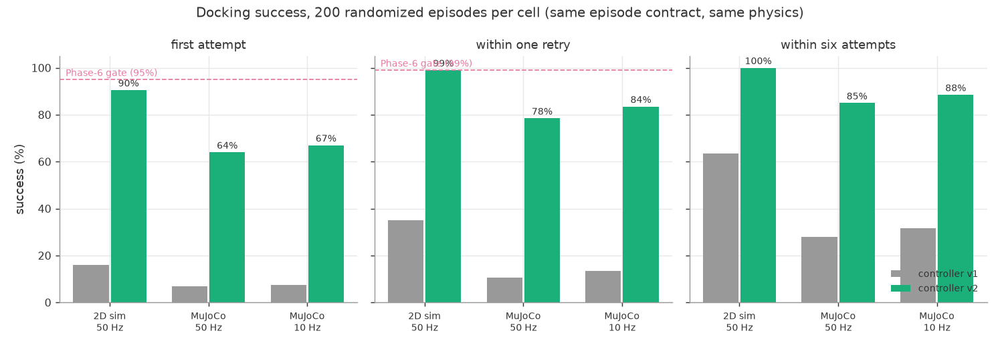

# Physics cross-validation: 2D sim vs MuJoCo 3D rig

> 2026-07-28. Two measurements live in this document, taken with the SAME
> episode contract and the SAME physics in both engines:
>
> - **controller v1** — the reactive beam-hold, the Phase-10 cross-validation
>   that this rig was built to run;
> - **controller v2** — planner + draft estimator + boom placement, the
>   control-layer answer to what v1's failures said.
>
> Nothing in the physics, the episode contract, or the capture model changed
> between them (Constitution Art. II §4). Raw numbers:
> `docs/assets/physics3d_results.json` and `docs/assets/physics2d_results.json`.
> `make physics3d` reruns MuJoCo, `make dock-bench` the 2D side.

## Headline

v1 scored **16% first-attempt in the 2D sim and 7% in MuJoCo**, and missed in
the same place in both — the reactive lateral loop could not hold the beam
against drafts of its own magnitude, and its own abort gates threw away
approaches it was winning.

v2 scores **90.5% first-attempt in 2D and 64% in MuJoCo**
(100% / 85% within six attempts), with **100% first-attempt in
calm air** — which is the useful part of the result: what is left of the miss
is drafts, not the controller. The Phase-6 gate (>95% first-attempt AND >99%
within one retry) is **still NOT MET**: 2D lands at 90.5% / 99%,
just under both bars, and MuJoCo well under.



## The episode contract (identical for every number in this document)

Random start within 3 m of the dock (front half-space, ±60°; the 2D runner
draws from anywhere in the floor plan), random heading, z 0.6-1.8 m, net
buoyancy drawn from ±5 gf (both signs, drifting), HVAC drafts ON, σ-5 cm room
pose, 20 Hz dock camera, 100 ms command latency, **6 attempts max**, 200
randomized episodes per cell. An "attempt" is what it always was: a retreat
to the 1.5 m standoff and a fresh approach, counted by the same retry counter
that ends the episode at 6.

## Controller v1 — the cross-validation

| Metric | 2D sim (50 Hz) | MuJoCo 50 Hz | MuJoCo 10 Hz |
|---|---|---|---|
| First-attempt success | **16.0%** | **7.0%** | 7.5% |
| Success within one retry | 35.0% | 10.5% | 13.5% |
| Success within six attempts | 63.5% | 28.0% | 31.5% |
| Median time-to-dock (successes) | 83.9 s | 81.6 s | 64.1 s |
| p90 time-to-dock | 157.2 s | 129.3 s | 115.5 s |
| Median approach speed at mouth contact | n/a (not recorded) | 0.214 m/s | 0.258 m/s |
| Max capture speed observed | n/a | 0.392 m/s | 0.423 m/s |
| Captures across buoyancy range | yes, both signs | -4.9..+4.8 gf | -4.9..+4.8 gf |

Failure modes, MuJoCo 50 Hz (144 failed episodes, all `DOCK_FAILED` after 6
attempts — no timeouts):

- **FINAL_APPROACH aborts dominate: 772** (predicted-miss and mouth-gate
  trips). Same signature as the 2D root-cause analysis: with near-zero drag
  and single-digit-gf authority, the reactive lateral loop cannot hold the
  beam against drafts of the same magnitude; braking poisons steering.
- **CAPTURE_PENDING aborts: 209.** The cone is 35 cm deep (vs 10 cm in the 2D
  funnel), so the in-funnel slide takes seconds and the "bounced off" gate
  (`v_axis < -0.10`) plus the "went past beside the dock" gate (dead-reckoned
  lateral > 0.15 m on σ-5 cm noise at range < -0.2 m) fire mid-slide. 35 of
  the 144 failures died within **5 cm** of the magnet.
- 247 mouth entries across 200 episodes: the controller reached the cone far
  more often than it captured. Getting IN the funnel was not the hard part;
  surviving the slide gates was.

Instrumenting *which* gate fired (`abort_reasons`, now permanent) put numbers
on it: 2D `mouth_gate` 341 / `predicted_miss` 245; MuJoCo `mouth_gate` 506 /
`slide_bypass` 181 / `predicted_miss` 171 / `camera_stale` 95.

## After controller v2

| Metric | 2D 50 Hz | 2D 10 Hz | 2D calm air | MuJoCo 50 Hz | MuJoCo 10 Hz |
|---|---|---|---|---|---|
| First-attempt success | **90.5%** | 78.5% | **100%** | **64%** | 67% |
| Success within one retry | 99% | 96% | 100% | 78.5% | 83.5% |
| Success within six attempts | 100% | 99.5% | 100% | 85% | 88.5% |
| Median time-to-dock (successes) | 62.3 s | 81.0 s | 40.8 s | 48.46 s | 56.7 s |
| p90 time-to-dock | 120.4 s | 177.7 s | 57.3 s | 172.0 s | 167.3 s |
| Median speed at mouth contact | n/a | n/a | n/a | 0.212 m/s | 0.194 m/s |
| Max capture speed observed | n/a | n/a | n/a | 0.408 m/s | 0.438 m/s |
| Total aborts (200 episodes) | 21 | — | **0** | 150 | — |
| In-approach re-plans | 214 | — | 1 | 752 | — |

Change vs v1, first-attempt: **16.0% → 90.5%** in 2D and
**7.0% → 64%** in MuJoCo. Within six: 63.5% → 100% and
28.0% → 85%.

### What changed (control layer only — no physics, no contract)

1. **In-funnel gates rewritten** (`meemoo/flight/dock_slide.py`). Inside the
   cone the dock camera is blind by construction, so range and lateral are a
   σ-5 cm room pose swung through a 0.3-0.6 m boom. The rules now: contact
   telemetry outranks dead reckoning; never abort while the range to the
   magnet is shrinking; a retreat must be sustained AND must have undone real
   progress; a funnel narrows, so a *growing* lateral means we are leaning on
   the rim, not sliding; a stalled slide gets pushed harder (6 → 12 gf) before
   it is abandoned, and when it is abandoned it goes back to the planner
   rather than back to the standoff. Near-magnet deaths (<5 cm) in MuJoCo:
   **35 → 18**.
2. **A commit planner replaced the abort gates** (`dock_plan.py`). Inside
   0.62 m the controller now decides one thing per tick — commit through the
   mouth, or hold range on the corridor until the window opens — on a
   feasibility test rather than a ballistic one:
   `a_req = 2·|l + v_l·T| / T²` plus what the draft is taking, against the
   lateral acceleration the airframe actually has. Holding costs seconds; the
   v1 go-around cost an attempt and ~25 s, and 341 (2D) / 506 (MuJoCo) of its
   aborts fired inside 30 cm with a 5-15 cm error.
3. **A draft estimator** (`draft.py`): a two-state Luenberger observer per
   axis on (velocity, ambient force). The base station knows what it
   commanded, the mixer that shaped it, the 100 ms radio delay and the
   effective mass; whatever the measured velocity does that thrust does not
   explain is the draft. Deterministic, ~1.1 s bandwidth (the field wanders
   with τ = 20 s), and its `confidence` scales its own authority so a confused
   estimate does nothing rather than something wrong.
4. **Boom placement replaced beam-holding** (`docking_laws._path_follow`) —
   the single biggest lever, and the one the 3D rig taught us. The funnel
   judges the NOSE, and the nose is on a boom: `l_nose = l_body + arm·sin φ`.
   Yaw is therefore a lateral actuator with a 0.3-0.6 m lever, and pointing at
   a *force vector* (v1, and our own first v2 cut) swings the capture point
   half a metre for a 3 gf draft — measured in MuJoCo as ±1 m of nose
   cross-error cycling at the gate. v2 commands the heading kinematically —
   the crab angle that puts the nose on the corridor — and lets thrust
   magnitude carry the closing speed. The two agree at equilibrium: holding a
   crosswind needs `F·sin φ = draft`, and that same φ parks the body exactly
   `arm·sin φ` downwind with the boom reaching back onto the axis. It also
   degrades well — with no thrust at all, yaw still holds the nose on the
   corridor while `|l_body| < arm`.
5. **Arrival speed is now a capture constraint.** v1's speed equilibrated
   ABOVE `v_max_capture` (its own comment predicted it; MuJoCo measured
   0.214 m/s median against a 0.15 m/s limit), so the 2D funnel was rejecting
   approaches that were dead on line — `too_fast` rejections the controller
   never saw. v2 plans the whole leg at 0.55-0.85 of the limit and refuses to
   commit while already too fast, which also buys cross-error authority since
   `a_req` falls as 1/T². **Honest caveat: this bites in the 2D capture model
   and not in MuJoCo**, whose measured entry speed is unchanged (0.212 vs
   0.214 m/s). The 3D rig has no speed GATE — capture there is contact
   physics — so a fast tip is punished by bouncing rather than by rejection,
   and the recorded number is the 3D speed magnitude at the mouth crossing,
   not the planned axial closing rate. Which of the two the bench validates
   is a Phase-9 question (research/06 §F).
6. **Recovery instead of retreat.** A tracking loss backs OFF along the axis
   to widen the camera's cone (its usable width grows as ~1.73·r) instead of
   going around. Measured cause of the losses, both engines: the cone, not
   the mouth-plane blind spot — 41 of 47 in 2D, 44 of 47 in MuJoCo. Passing
   the mouth plane off-axis flies back out and re-plans. And TRANSIT finally
   uses the aim-then-hold hover primitive that `nav.py` documents:
   20 of 200 2D episodes had been circling the standoff at 0.3 m / 0.28 m/s
   until the 90 s phase timeout — an attempt spent before docking even began.

Two controller-internal budgets grew to pay for the holds: FINAL_APPROACH
40 → 75 s and CAPTURE_PENDING 15 → 25 s. They are still hard caps, the clock
does NOT restart on an in-approach re-plan, and the episode-level contract
(6 attempts, 340 s) is untouched. This is the honest cost of holding for a
window instead of going around, and it is visible in the time-to-dock rows.

### Where the remaining failures are

The character of failure changed, and the change is worth more than the
headline number:

- **MuJoCo failures are now clock-limited, not attempt-limited.** All 30
  remaining 50 Hz failures ended by running out of the 340 s EPISODE budget
  while still working the problem (end phase: FINAL_APPROACH 17, ALIGN 6,
  ABORT 4, CAPTURE_PENDING 3). Not one spent its six attempts. v1's 144
  failures were the exact opposite: every one was `DOCK_FAILED` with the
  retry counter exhausted. That is the direct cost of trading go-arounds for
  holds, and it shows in p90 time-to-dock (129.3 → 172.0 s in MuJoCo, though
  2D improved, 157.2 → 120.4 s). The episode budget was NOT extended to
  flatter the result.
- **The last centimetres now dominate what is left.** 18 of the 30 MuJoCo
  failures died within 5 cm of the magnet (v1: 35 of 144). Absolute
  near-magnet deaths roughly halved, but as a share of failures they went
  from a quarter to three fifths — so the residual is mostly a tip stalling
  in the throat/centering cup, which is physical finding 2's territory, not
  the controller's.
- **Reaching the cone stopped being interesting.** 546 mouth entries across
  200 MuJoCo episodes (v1: 247).

### Evaluated, and what happened to each

- **Upwind-preferred approach azimuth** — subsumed, not adopted as its own
  mechanism. The dock's axis is fixed by the hardware, so the only free
  choice is where the vehicle sits relative to the corridor, and the boom
  placement law already lands on the right answer by construction: the
  crab that cancels the draft parks the body `arm·sin φ` DOWNWIND with the
  boom reaching upwind onto the axis. A separate upwind bias on top of that
  would double-count the same geometry. The hover target inherits it for
  free (the offset is computed from the vehicle's own heading, filtered).
- **Slower creep with the A5 governor** — adopted, but the governor is not
  the binding constraint. A5 caps speed at 1.3 m/s; docking happens at ~0.1.
  The real limit is the funnel's `v_max_capture` = 0.15 m/s, which v1 was
  exceeding without ever seeing it (MuJoCo measured 0.214 m/s median contact
  speed). v2 plans the whole leg at 0.55-0.85 of that limit and refuses to
  commit above 0.9 of it. That is the creep, and it paid twice: fewer
  "too fast" rejections, and a longer horizon in which to null cross error.
- **Re-plan instead of full retreat** — adopted, and it is most of the
  improvement. Two flavours: the planner holds range at the gate instead of
  going around (214 2D / 752 MuJoCo re-plans across
  200 episodes each), and a slide that stalls or bounces hands back to the
  planner instead of retreating. Neither spends a retry, and the retry
  counter itself is untouched — a go-around still means the 1.5 m standoff,
  and the episode still dies at 6 of them.

### What it did not fix

- **Drafts of the same magnitude as control authority are still the whole
  problem.** Calm air is 100% first-attempt with literally zero aborts across
  200 episodes; every remaining failure has wind in it. The dominant remaining
  abort in both engines is a tracking loss while the vehicle is being blown
  off the corridor (12 in 2D, 83 in MuJoCo), which is the same
  root cause wearing a different hat.
- **MuJoCo still scores well below the 2D sim** (64% vs
  90.5% first-attempt). The gap narrowed but did not close, and the
  reasons are physical: a 0.585 m boom (forced by the assigned cone geometry,
  finding 1), true contact dynamics in a 35 cm cone, and a wind-through-drag
  draft model that reaches ~6 gf against the 2D field's 3 gf clamp.
- **The >95% gate.** Not met, in either engine. It is not met by 4.5 points in
  2D and by a wide margin in MuJoCo, and no number in this document was moved
  to make it look closer.

## Bump test: 1 N × 0.2 s shove mid-hover, 50 paired episodes

| Metric | damper ON (50 Hz) | damper OFF (50 Hz) | damper ON (10 Hz) | damper OFF (10 Hz) |
|---|---|---|---|---|
| Median peak tilt after shove | 18.7 deg | 18.9 deg | 17.6 deg | 17.7 deg |
| Runs reaching <2 deg for 3 s within 60 s | 10/50 | 6/50 | 6/50 | 4/50 |
| Median settle time (settled runs only) | 5.4 s | 5.9 s | 12.8 s | 14.1 s |

Unchanged by the controller work — this test flies `nav.hover_command`, which
v2 did not touch. Honest reading (see `docs/assets/physics3d_bump_settle.png`):
the shove transient itself dies in ~3-5 s, but the hover CONTROLLER sustains a
3-7 deg rocking at the pendulum period indefinitely — thrust acts at the
gondola, 78 mm below the center of buoyancy, so every horizontal correction
pitches the vehicle. The 2 deg settle band is therefore rarely held, damper or
not. And the damper's effect is marginal in 3D because a random-azimuth shove
mostly excites ROLL, which forward-thrust rate feedback cannot touch (the
published "swing-reducer" only lives in the pitch plane). At 10 Hz the damper
is actively counterproductive on the true 1.4 s pendulum in single-seed tests
(phase lag from 100 ms latency + ZOH turns rate feedback into excitation);
across the ensemble it nets out to roughly no effect.

## Physical findings (the 3D-only deliverables)

1. **The assigned dock geometry forces a long docking boom.** A 0.61 m sphere
   cannot enter a 40 cm mouth: it seats on the mouth rim with its center 23 cm
   out. Reaching a magnet 35 cm deep therefore requires a probe ~0.585 m from
   sphere center — a **28 cm boom** proud of the envelope. Bench question:
   probe length vs cone depth tradeoff (a shallower cone with the magnet at
   the rim-seat point needs almost no boom). *Controller consequence, new in
   v2: the boom is also the vehicle's best lateral actuator, so this trade
   decides control authority as well as reach.*
2. **A 12 cm throat cannot hand the tip to a 15 mm-proximity magnet.**
   Measured in-rig: the tip slides the cone and stalls at the throat opening
   up to 5 cm off the magnet axis — capture NEVER triggers. The rig adds a
   second-stage centering cup (12 cm → 1.2 cm over the last 6 cm of the same
   35 cm depth); with it, capture works from 12 cm of initial lateral offset.
   The bench funnel needs the same feature (or a much bigger magnet face).
3. **The 2D sim's added mass is ~2x the first-principles value.** MuJoCo's
   ellipsoid model computes the sphere's virtual mass as 0.5*rho*V = 71.5 g;
   the 2D sim (per research/06 §G) uses the full displaced mass, 144.5 g.
   Effective inertia: 197 g (engine) vs 269.5 g (2D). The controller was left
   believing the 2D value — model error is part of the test — and still worked
   at the same order of success. The 2D constant should be revisited against
   bench data, not silently changed. (Engine gap found on the way: MuJoCo 3.10
   computes the virtual-mass coefficient but never applies the linear
   acceleration-reaction force — verified with a sphere in density-1000 fluid
   accelerating at F/m. The rig applies the reaction force itself using the
   engine's own coefficient; see `sim3d/world.py`.)
4. **The pendulum is faster than the 2D constant.** First-principles period
   1.40 s (buoyancy-at-center vs COM 78 mm below, engine-computed inertia) vs
   the 2.2 s the 2D sim assumes. Consequence measured above: the swing damper
   is rate-marginal at 10 Hz. The 2D `swing_period_s` came from a research
   estimate of added-mass stretching; the bench (hang the real gondola, shove
   it) settles this in one afternoon.

## What this does and does not validate

- VALIDATED: the five §G behaviors reproduce in an independent engine (added
  mass/coasting, both-sign buoyancy drift, per-motor thrust saturation, funnel
  + two-signal magnet capture, few-gf drafts), and the 2D sim's failure
  diagnosis (lateral authority vs drafts) is not an artifact of our own
  physics code.
- VALIDATED, and this is what the second run bought: **the v2 control changes
  help in BOTH engines**, by 5.7x (2D) and 9.1x (MuJoCo) on
  first-attempt success, with no physics or contract change. A fix that only
  worked in the engine it was tuned in would have shown up here.
- NOT VALIDATED: absolute success rates. MuJoCo still lands ~26 points below
  the 2D sim on first attempt (64% vs 90.5%) and 15 below on within-six.
  Neither engine is the truth — the Phase-9 bench is.
- The Phase-6 gate (>95% first-attempt, >99% within one retry) remains NOT MET
  in both engines. The remaining lever is no longer a planner; it is authority
  against drafts — more control margin (thrust, or fins that buy damping for
  free), a shallower cone (but see finding 1: the boom is also the best
  lateral actuator, so that trade now cuts both ways), or siting the dock out
  of the draft field. Phase-9 bench data on R_capture, v_max and real draft
  magnitudes decides which; nothing here should be tuned further against a
  simulator.

## Reproduce

```bash
make physics3d                                   # MuJoCo: 200 episodes x {50,10} Hz + 50 bumps + plots (~25 min)
make dock-bench                                  # 2D: the same 200 episodes x {50,10} Hz + calm air (~2 min)
uv run --group physics3d python -m sim3d.plots   # refresh the v1-vs-v2 figure
uv run --group physics3d pytest tests/sim3d      # rig behavior tests (~1 s)
uv run pytest tests/flight/test_dock_plan.py     # controller-v2 logic gates
```
